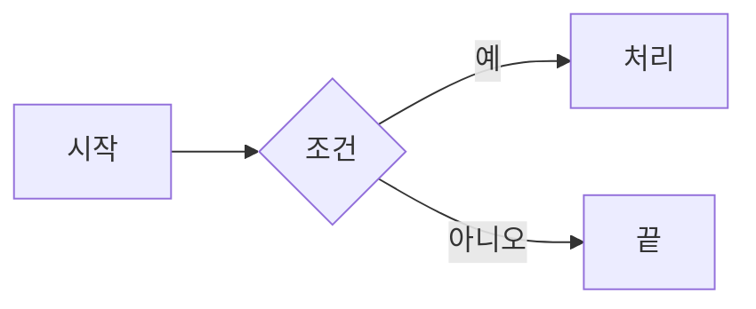
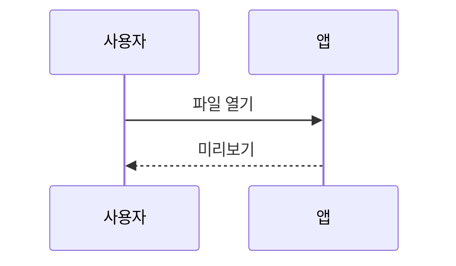

# 수식 · 다이어그램 샘플

인라인 수식: $E = mc^2$, 근의 공식 $x = \frac{-b \pm \sqrt{b^2-4ac}}{2a}$

블록 수식:

$$
\sum_{i=1}^{n} i = \frac{n(n+1)}{2}
$$

## 다이어그램





<!-- pagebreak -->

## 2쪽

| 항목 | 값 |
| ---- | -- |
| 가   | 1  |

```js
console.log('코드 강조')
```

잘못된 다이어그램:

```mermaid
graph LR
  A --> 
```
